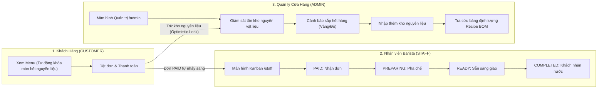
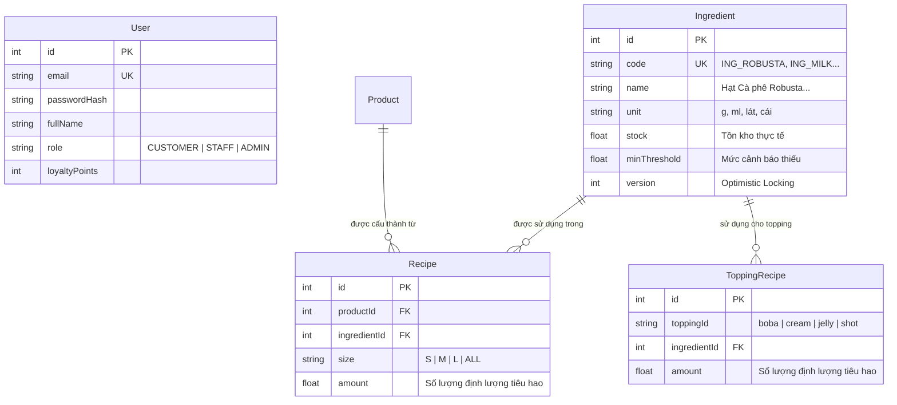
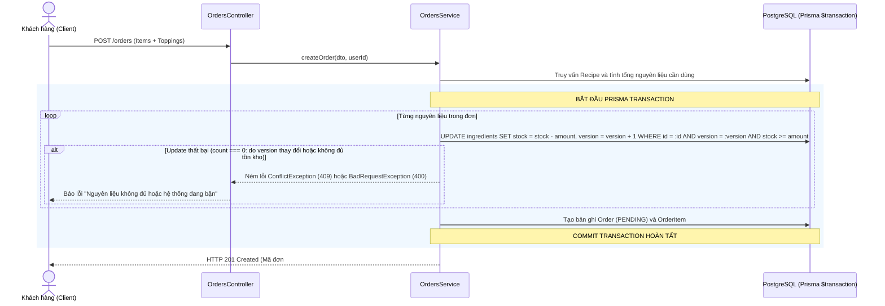

# 🚀 BẢN KẾ HOẠCH THỰC THI PHÂN HỆ MỞ RỘNG: SPRINT 4 (PHÂN QUYỀN RBAC, BARISTA POS & QUẢN LÝ NGUYÊN VẬT LIỆU BOM)
> **Dự án:** BrewLite — Nền Tảng Đặt & Thanh Toán Cà Phê Không Tiền Mặt  
> **Phiên bản:** Sprint 4 Extension (Bổ sung tính năng nâng cao & điểm cộng)  
> **Căn cứ yêu cầu:** `BrewLite-CongNghePhanMem.md` (Mục 3.2 Stakeholders & Mục 9 Task 10 Nghiệp vụ Quản lý Nguyên vật liệu/Tồn kho).  
> **Ngày lập:** Tháng 10, 2026  

---

## 📌 1. TỔNG QUAN PHÂN HỆ MỞ RỘNG (EXPANSION SCOPE)

Phân hệ mở rộng Sprint 4 giải quyết trọn vẹn bài toán vận hành thực tế của chuỗi đồ uống BrewLite với sự tham gia đầy đủ của **3 nhóm Stakeholder chính**:



---

## 🔐 2. HỆ THỐNG PHÂN QUYỀN (ROLE-BASED ACCESS CONTROL - RBAC)

### 2.1. Danh mục 3 Vai trò (User Roles)
* **`CUSTOMER` (Khách hàng):** Duyệt Menu, chọn Size/Topping, thanh toán đơn, tích lũy điểm thưởng Hạt Vàng, xem lịch sử đơn.
* **`STAFF` (Nhân viên quầy / Barista):** Xem danh sách đơn cần pha chế theo thời gian thực trên Kanban Board, chuyển đổi trạng thái đơn hàng (`PAID → PREPARING → READY → COMPLETED`).
* **`ADMIN` (Quản trị viên / Quản lý cửa hàng):** Kiểm soát toàn bộ kho nguyên vật liệu, định lượng công thức pha chế, nhập kho, quản trị người dùng và giám sát doanh thu.

### 2.2. Luồng Đăng nhập & Tự động Điều hướng (Smart Redirection)
Dùng chung 1 trang đăng nhập chuẩn tại `/login`. Sau khi người dùng xác thực thành công, Backend trả về JWT Payload chứa claim `role`. Frontend (`authStore.ts`) tự động điều hướng:

* Nếu `role === 'ADMIN'` $\rightarrow$ Chuyển hướng vào trang Dashboard quản trị: `/admin`
* Nếu `role === 'STAFF'` $\rightarrow$ Chuyển hướng vào màn hình tiếp nhận pha chế: `/staff`
* Nếu `role === 'CUSTOMER'` $\rightarrow$ Chuyển hướng về trang chủ Menu `/menu` hoặc trang Giỏ hàng `/cart` nếu đang đặt dở.

### 2.3. Danh sách Tài khoản Khởi tạo Sẵn (Seed Data)
| Vai trò (Role) | Email đăng nhập | Mật khẩu mặc định | Mục đích sử dụng / Quyền hạn |
| :--- | :--- | :--- | :--- |
| **ADMIN** | `admin@brewlite.vn` | `Admin@123` | Quản lý kho nguyên vật liệu, định lượng BOM, nhập hàng |
| **STAFF** | `staff@brewlite.vn` | `Staff@123` | Nhân viên Barista tiếp nhận đơn và cập nhật trạng thái |
| **CUSTOMER** | `khach@brewlite.vn` | `Password123` | Khách hàng mẫu có sẵn 120 điểm Hạt Vàng để test giỏ hàng |

---

## 🗄️ 3. THIẾT KẾ CSDL NGUYÊN VẬT LIỆU & ĐỊNH LƯỢNG (BOM RECIPE)

### 3.1. Sơ đồ Thực thể Bổ sung (ERD)



### 3.2. Cập nhật Prisma Schema (`backend/prisma/schema.prisma`)

```prisma
// Thêm Enum Role vào hệ thống
enum Role {
  CUSTOMER
  STAFF
  ADMIN
}

// Cập nhật model User
model User {
  id            Int      @id @default(autoincrement())
  email         String   @unique
  passwordHash  String
  fullName      String?
  phone         String?
  role          Role     @default(CUSTOMER) // Phân quyền người dùng
  loyaltyPoints Int      @default(0)
  createdAt     DateTime @default(now())
  orders        Order[]

  @@map("users")
}

// Model 1: NGUYÊN VẬT LIỆU KHO (Ingredient)
model Ingredient {
  id           Int      @id @default(autoincrement())
  code         String   @unique // Ví dụ: ING_ROBUSTA, ING_MILK_CONDENSED
  name         String   // Tên nguyên liệu: Hạt Cà phê Robusta, Sữa tươi...
  unit         String   // Đơn vị tính: g, ml, lát, chiếc
  stock        Float    @default(0) // Số lượng tồn kho hiện tại
  minThreshold Float    @default(100) // Ngưỡng cảnh báo sắp hết hàng
  version      Int      @default(0) // Phục vụ Optimistic Locking chống bán vượt tồn kho
  createdAt    DateTime @default(now())
  updatedAt    DateTime @updatedAt

  recipes        Recipe[]
  toppingRecipes ToppingRecipe[]

  @@map("ingredients")
}

// Model 2: CÔNG THỨC ĐỊNH LƯỢNG MÓN CHÍNH (Recipe / Bill of Materials)
model Recipe {
  id           Int        @id @default(autoincrement())
  productId    Int
  ingredientId Int
  size         String     @default("ALL") // S, M, L hoặc ALL nếu không phân size
  amount       Float      // Định lượng tiêu hao cho 1 ly theo size

  product      Product    @relation(fields: [productId], references: [id], onDelete: Cascade)
  ingredient   Ingredient @relation(fields: [ingredientId], references: [id], onDelete: Cascade)

  @@unique([productId, ingredientId, size])
  @@map("recipes")
}

// Model 3: ĐỊNH LƯỢNG NGUYÊN LIỆU CHO TOPPING (ToppingRecipe)
model ToppingRecipe {
  id           Int        @id @default(autoincrement())
  toppingId    String     // boba, cream, jelly, shot
  ingredientId Int
  amount       Float      // Định lượng tiêu hao cho mỗi phần topping

  ingredient   Ingredient @relation(fields: [ingredientId], references: [id], onDelete: Cascade)

  @@unique([toppingId, ingredientId])
  @@map("topping_recipes")
}
```

---

## ☕ 4. BẢNG CÔNG THỨC ĐỊNH LƯỢNG THỰC TẾ (F&B RECIPE MATRIX)

Bảng định lượng chi tiết dựa theo tiêu chuẩn vận hành quán cà phê thực tế cho **10 sản phẩm đồ uống/bánh** và **4 loại Topping** hiện có của BrewLite:

### 4.1. Danh mục 12 Nguyên vật liệu cốt lõi trong kho (Kho khởi tạo)
| Mã nguyên liệu (`code`) | Tên nguyên vật liệu | Đơn vị | Tồn kho khởi tạo mẫu | Mức cảnh báo thiếu (`minThreshold`) |
| :--- | :--- | :---: | :---: | :---: |
| `ING_ROBUSTA` | Hạt Cà phê Robusta Đắk Lắk mộc | g | 5,000 g (5kg) | 500 g |
| `ING_ARABICA` | Hạt Cà phê Arabica Cầu Đất | g | 3,000 g (3kg) | 300 g |
| `ING_MILK_COND` | Sữa đặc có đường Ngôi Sao Phương Nam | ml | 10,000 ml (10L) | 1,000 ml |
| `ING_MILK_FRESH`| Sữa tươi thanh trùng không đường Barista | ml | 15,000 ml (15L) | 1,500 ml |
| `ING_CREAM_RICH`| Kem béo thực vật Rich's & Whipping Cream | ml | 5,000 ml (5L) | 500 ml |
| `ING_MATCHA` | Bột Trà Xanh Uji Matcha Nhật Bản | g | 1,000 g (1kg) | 150 g |
| `ING_TEA_BLACK` | Cốt Trà Đen Ceylon thượng hạng | ml | 10,000 ml (10L) | 1,000 ml |
| `ING_PEACH` | Đào miếng ngâm đường giòn giòn | lát | 200 lát | 30 lát |
| `ING_SYRUP_ORANGE`| Siro Cam Vàng & Sả Tươi đun đường | ml | 3,000 ml (3L) | 300 ml |
| `ING_CARAMEL` | Sốt Caramel béo vàng óng | ml | 2,000 ml (2L) | 200 ml |
| `ING_BOBA` | Trân Châu Trắng 3Q ngâm đường | g | 4,000 g (4kg) | 500 g |
| `ING_SEA_SALT` | Muối Biển Tinh Khiết Hầm Mịn | g | 1,000 g (1kg) | 100 g |

---

### 4.2. Định lượng chi tiết cho 10 Món Sản Phẩm (Theo Size S/M/L)

| ID | Tên sản phẩm | Size S (Nhỏ - 250ml) | Size M (Vừa - 350ml - Tiêu chuẩn) | Size L (Lớn - 450ml) |
|:---:|:---|:---|:---|:---|
| **1** | **Cà phê Đen** | • `ING_ROBUSTA`: 20g | • `ING_ROBUSTA`: 25g | • `ING_ROBUSTA`: 30g |
| **2** | **Cà phê Sữa** | • `ING_ROBUSTA`: 20g<br>• `ING_MILK_COND`: 30ml | • `ING_ROBUSTA`: 25g<br>• `ING_MILK_COND`: 40ml | • `ING_ROBUSTA`: 30g<br>• `ING_MILK_COND`: 50ml |
| **3** | **Cà phê Bạc Xỉu** | • `ING_ROBUSTA`: 12g<br>• `ING_MILK_COND`: 35ml<br>• `ING_MILK_FRESH`: 70ml | • `ING_ROBUSTA`: 15g<br>• `ING_MILK_COND`: 45ml<br>• `ING_MILK_FRESH`: 100ml | • `ING_ROBUSTA`: 20g<br>• `ING_MILK_COND`: 55ml<br>• `ING_MILK_FRESH`: 130ml |
| **4** | **Cà phê Muối** | • `ING_ROBUSTA`: 20g<br>• `ING_MILK_COND`: 25ml<br>• `ING_CREAM_RICH`: 35ml<br>• `ING_SEA_SALT`: 1g | • `ING_ROBUSTA`: 25g<br>• `ING_MILK_COND`: 35ml<br>• `ING_CREAM_RICH`: 45ml<br>• `ING_SEA_SALT`: 1.5g | • `ING_ROBUSTA`: 30g<br>• `ING_MILK_COND`: 45ml<br>• `ING_CREAM_RICH`: 60ml<br>• `ING_SEA_SALT`: 2g |
| **5** | **Iced Caramel Macchiato** | • `ING_ARABICA`: 16g<br>• `ING_MILK_FRESH`: 100ml<br>• `ING_CARAMEL`: 15ml | • `ING_ARABICA`: 20g<br>• `ING_MILK_FRESH`: 130ml<br>• `ING_CARAMEL`: 20ml | • `ING_ARABICA`: 24g<br>• `ING_MILK_FRESH`: 160ml<br>• `ING_CARAMEL`: 25ml |
| **6** | **Matcha Latte Uji** | • `ING_MATCHA`: 10g<br>• `ING_MILK_FRESH`: 120ml | • `ING_MATCHA`: 14g<br>• `ING_MILK_FRESH`: 150ml | • `ING_MATCHA`: 18g<br>• `ING_MILK_FRESH`: 180ml |
| **7** | **Trà Đào Cam Sả** | • `ING_TEA_BLACK`: 120ml<br>• `ING_SYRUP_ORANGE`: 20ml<br>• `ING_PEACH`: 2 lát | • `ING_TEA_BLACK`: 160ml<br>• `ING_SYRUP_ORANGE`: 30ml<br>• `ING_PEACH`: 3 lát | • `ING_TEA_BLACK`: 200ml<br>• `ING_SYRUP_ORANGE`: 40ml<br>• `ING_PEACH`: 4 lát |
| **8** | **Bánh Pain au Chocolat** | — Cố định: 1 chiếc (Quản lý tồn kho bánh nguyên chiếc) — |
| **9** | **Basque Burnt Cheesecake** | — Cố định: 1 lát (Quản lý tồn kho lát bánh sẵn) — |
| **10**| **Classic Tiramisu** | — Cố định: 1 phần (Quản lý tồn kho phần bánh sẵn) — |

---

### 4.3. Định lượng cho 4 loại Topping chọn thêm
1. **Trân châu trắng giòn (`boba`):** Tiêu hao `40g ING_BOBA`.
2. **Thêm Kem Muối Béo (`cream`):** Tiêu hao `35ml ING_CREAM_RICH` + `1g ING_SEA_SALT`.
3. **Thạch Cà Phê Phin (`jelly`):** Tiêu hao `10g ING_ROBUSTA` (chiết xuất thạch).
4. **Thêm 1 Shot Espresso (`shot`):** Tiêu hao `18g ING_ARABICA`.

---

## ⚡ 5. CƠ CHẾ TRỪ TỒN KHO ĐỒNG THỜI (OPTIMISTIC LOCKING ENGINE)

Đây là cơ chế đáp ứng 100% tiêu chí **Mục 9 (Task 10)** của đề tài: *Không bao giờ bán vượt quá số lượng nguyên vật liệu còn lại khi nhiều khách hàng cùng bấm đặt hàng đồng thời*.



### Quy tắc hoàn kho tự động:
* Khi đơn hàng chuyển sang `CANCELLED` (Khách hủy hoặc thanh toán thất bại hết hạn): Hệ thống chạy một transaction hoàn lại đúng số lượng nguyên vật liệu đã trừ trước đó (`stock = stock + amount`, `version = version + 1`).
* **Khóa món tự động trên Menu:** Endpoint `GET /products` sẽ kiểm tra tồn kho nguyên liệu. Nếu một nguyên liệu chính bị cạn (không đủ làm 1 ly Size S), sản phẩm tương ứng sẽ được gắn cờ `isOutOfStock: true` $\rightarrow$ Nút đặt hàng trên giao diện chuyển thành nhãn **"Hết hàng" (Sold Out)** màu xám.

---

## 🖥️ 6. MÀN HÌNH NHÂN VIÊN BARISTA (`/staff`) — TASK 11

### 6.1. Giao diện Bảng Thẻ Kanban 3 Cột (Barista Kitchen Display System - KDS)
Giao diện trực quan chia làm 3 cột tiến độ làm việc:

| Cột 1: Chờ Tiếp Nhận (`PAID`) | Cột 2: Đang Pha Chế (`PREPARING`) | Cột 3: Chờ Giao Nước (`READY`) |
| :--- | :--- | :--- |
| • Thẻ đơn hàng màu vàng nổi bật.<br>• Hiện mã đơn to rõ (`#1042`), giờ đặt.<br>• Danh sách món, Size, Topping và Ghi chú Barista.<br>👉 **Nút bấm: [Bắt đầu pha chế ☕]** | • Thẻ đơn hàng màu xanh dương.<br>• Có đồng hồ đếm thời gian đang pha.<br>• Barista nhìn công thức định lượng nếu cần.<br>👉 **Nút bấm: [Hoàn thành pha chế ✅]** | • Thẻ đơn hàng màu xanh lá.<br>• Sẵn sàng tại quầy Express Pickup.<br>• Khi khách đọc mã đơn lấy nước.<br>👉 **Nút bấm: [Đã giao khách 🎉]** |

### 6.2. Cơ chế Polling tự động 3 giây
Màn hình `/staff` tự động kích hoạt `setInterval` gọi `GET /orders/barista/queue` mỗi 3 giây. Ngay khi khách hàng ở quầy quét mã VietQR thành công chuyển đơn sang `PAID`, thẻ đơn hàng sẽ **tự động nhảy tinh ting lên màn hình Barista** mà nhân viên không cần phải bấm F5 tải lại trang.

---

## 🛠️ 7. MÀN HÌNH QUẢN TRỊ VIÊN ADMIN (`/admin`) — TASK 12

Giao diện Quản trị dành cho Chủ quán / Quản lý cửa hàng gồm 3 phân hệ chính:

### 7.1. Phân hệ Quản lý Tồn kho Nguyên Vật Liệu (`/admin/inventory`)
* **Bảng danh sách 12 nguyên vật liệu:**
  * Hiển thị: Tên nguyên liệu, Mã, Đơn vị tính, Số lượng tồn thực tế, Ngưỡng an toàn.
  * **Cảnh báo trực quan theo màu:**
    * 🟢 **Xanh lá:** Tồn kho dồi dào ($> 150\%$ mức an toàn).
    * 🟡 **Màu vàng cảnh báo:** Tồn kho sắp hết ($\le minThreshold$).
    * 🔴 **Màu đỏ báo động:** Tồn kho đã cạn kiệt ($= 0$, món ngoài Menu bị khóa tự động).
* **Modal Nhập thêm kho (Stock Inflow):**
  * Admin chọn nguyên liệu cần nhập, điền số lượng cộng thêm (ví dụ: nhập thêm 2,000g Hạt Cà phê).
  * Backend thực hiện cập nhật an toàn: `stock = stock + addAmount`, `version = version + 1`.

### 7.2. Phân hệ Tra cứu Định lượng Recipe Matrix (`/admin/recipes`)
* Hiển thị bảng ma trận định lượng trực quan của từng món:
  * Chọn món Cà phê Muối $\rightarrow$ Xem ngay định lượng chi tiết cho Size S, M, L.
  * Giúp quản lý kiểm soát hao hụt và giải trình công thức với Giảng viên/Khách hàng.

### 7.3. Phân hệ Thống kê Tiêu hao & Doanh thu (`/admin/dashboard`)
* Thống kê tổng số đơn hàng đã hoàn tất (`COMPLETED`).
* Tổng doanh thu thực tế sau khi trừ khuyến mãi.
* Thống kê tổng lượng nguyên vật liệu đã tiêu thụ trong ngày (ví dụ: đã dùng 1,250g cà phê Robusta, 2,400ml sữa đặc...).

---

## 📅 8. KẾ HOẠCH BỔ SUNG SPRINT 4 TRONG AGILE SCRUM

| Sprint | Task ID | Tên Nhiệm Vụ Mở Rộng | Chi tiết nội dung công việc | Phân công phụ trách | Story Points |
| :---: | :---: | :--- | :--- | :--- | :---: |
| **SPRINT 4** | **Task 11** | **Phân quyền RBAC & Màn hình Barista POS (`/staff`)** | • Bổ sung Enum `Role` (`CUSTOMER`, `STAFF`, `ADMIN`) vào CSDL & JWT claim.<br>• Seed tài khoản `staff@brewlite.vn` & `admin@brewlite.vn`.<br>• Xây dựng màn hình Kanban Barista 3 cột (`PAID → PREPARING → READY → COMPLETED`).<br>• Polling 3s tự động cập nhật đơn mới. | **Mã Gia Vỹ & Nguyễn Thị Ý** | 2 |
| | **Task 12** | **Quản lý Kho Nguyên liệu BOM & Optimistic Locking (`/admin`)** | • Bổ sung bảng `Ingredient`, `Recipe`, `ToppingRecipe` trong Prisma Schema.<br>• Seed bảng 12 nguyên liệu và định lượng thực tế cho 10 món đồ uống.<br>• Nâng cấp `POST /orders` trừ kho nguyên liệu bằng Optimistic Locking trong Prisma `$transaction`.<br>• Xây dựng màn hình Quản trị `/admin` quản lý tồn kho, cảnh báo hết hàng và form nhập kho. | **Quách Kỳ Minh & Huỳnh Tuấn Kiệt & Nguyễn Gia Thành** | 3 |

---

## 🏆 9. ĐỊNH NGHĨA HOÀN THÀNH (DEFINITION OF DONE) CHO PHÂN HỆ SPRINT 4

1. Đăng nhập tài khoản `admin@brewlite.vn` tự động chuyển vào `/admin`; tài khoản `staff@brewlite.vn` tự động vào `/staff`.
2. Khách đặt 1 ly Cà phê Muối Size M $\rightarrow$ Tồn kho nguyên vật liệu trong Database tự động bị trừ đúng: `25g Robusta, 35ml Sữa đặc, 45ml Kem Rich, 1.5g Muối`.
3. Khi cố tình giả lập 2 khách hàng cùng đặt ly cà phê cuối cùng khi kho chỉ còn đủ 25g cà phê $\rightarrow$ 1 khách thành công, 1 khách bị chặn và báo lỗi 409 Conflict (Chứng minh 100% tiêu chí Task 10).
4. Màn hình Barista nhận đơn và bấm chuyển trạng thái mượt mà theo đúng State Machine Guard `assertTransition`.
5. Đơn hàng bị hủy `CANCELLED` thì hệ thống tự động hoàn kho nguyên vật liệu đầy đủ.
